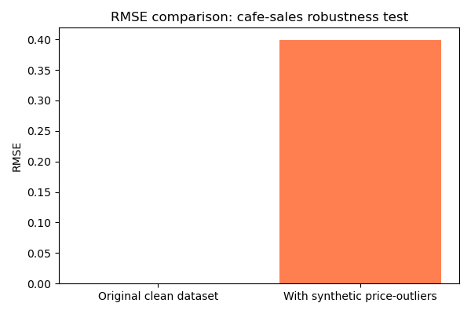

# Cafe-Sales-Robustness-Testing-Project
## Project Overview
 
This end‑to‑end analytics experiment tests how a baseline Random‑Forest predictive model responds when artificial extreme‑price outliers are introduced into real‑world‑style cafe‑sales transaction data. The work explores core robustness‑testing ideas supporting my broader portfolio theme: examining how machine‑learning pipelines cope with everyday real‑world data‑quality issues such as inconsistent entries and unexpected extreme‑value records.
 
## Dataset
 
  Source:  dirty_cafe_sales.csv  ‑ public‑format cafe‑transaction records containing text‑based bad entries such as  UNKNOWN  inside numeric columns
  Cleaned baseline dataset:  clean_cafe_sales.csv  ‑ after filtering non‑numeric rows; 8 544 valid rows
  Prediction task: predict Total Spent from Quantity and Price Per Unit
 
## Tools Used
 
  Python ‑ pandas, scikit‑learn RandomForestRegressor, matplotlib ‑ run via Anaconda / VS Code
 
Experimental Workflow
 
1. Load raw transaction CSV file
2. Force numeric conversion for Quantity, Price Per Unit and Total Spent ‑ turn unreadable‑text entries into NaN values
3. Remove incomplete rows to produce clean numeric‑only dataset; save this cleaned table
4. Train baseline Random‑Forest regression model; record baseline RMSE
5. Create modified dataset by adding 15 synthetic high‑price outlier records
6. Re‑train identical‑setup model; record new RMSE
7. Generate RMSE‑comparison bar‑chart; save key‑result summary‑text file
 
## Results & Visualisation

Chart explanation: The left‑hand bar shows near‑zero prediction error on our fully cleaned dataset. The taller right‑hand bar shows increased prediction error after we artificially introduced 15 extreme‑price outlier records to test model robustness. These synthetic outliers do not come from the original raw dataset; we added them deliberately as an experiment.
 
  Baseline RMSE (clean dataset): 0.00 ‑ near‑perfect prediction ‑ because Total Spent is mathematically Quantity × Price Per Unit
  RMSE (with synthetic price‑outliers): 0.40 ‑ measurable prediction‑error increase
  Observation: Even a simple‑performing model can lose prediction accuracy when exposed to unexpected extreme‑value entries; this illustrates the importance of robustness checks for operational‑data pipelines.
 
## Repository Contents
 
   cafe_sales_robust_analysis ‑ single‑file complete analysis script
   dirty_cafe_sales.csv  ‑ original source transaction dataset
   clean_cafe_sales.csv  ‑ saved cleaned numeric‑only baseline dataset
   cafe_robust_rmse_chart.png  ‑ RMSE‑comparison output chart
   experiment_summary.txt  ‑ saved experiment‑result notes
 
 
## Possible Future Extensions
 
  Test performance using alternative regression‑model types
  Introduce different simulated‑defect patterns ‑ missing‑value cases, mixed‑format entries
  Add simple explainability checks ‑ SHAP‑value analysis ‑ to examine feature‑influence shifts after outliers are added
  Created by
  ## Shumaila Liaqat
